# 02. ER Diagram & Data Modelling

**Project:** CareerCompass — Secondary School Guidance Platform
**Component:** Data Engineering Deliverable #2
**Author:** Aradhya Tiwari (Data Engineering Lead)

---

## 1. PostgreSQL Entity-Relationship (ER) Diagram

The diagram below represents the complete relational data model of CareerCompass. Primary keys (`PK`), Foreign keys (`FK`), Unique constraints (`UK`), and relationship cardinalities (`||--||`, `||--o{`, `}o--o{`) are explicitly detailed.

```mermaid
erDiagram
    users ||--o| student_profiles : "has (1:1)"
    users ||--o| counsellor_profiles : "has (1:1)"
    users ||--o{ refresh_sessions : "issues (1:N)"

    student_profiles ||--o{ assessment_attempts : "undertakes (1:N)"
    student_profiles ||--o{ saved_careers : "bookmarks (1:N)"
    student_profiles ||--o{ bookings : "schedules (1:N)"

    assessments ||--o{ questions : "contains (1:N)"
    assessments ||--o{ assessment_attempts : "evaluates (1:N)"
    questions ||--o{ answers : "records (1:N)"

    assessment_attempts ||--o{ answers : "submits (1:N)"
    assessment_attempts ||--o{ recommendations : "produces (1:N)"

    careers ||--o{ career_dimensions : "weighted_by (1:N)"
    careers ||--o{ career_skills : "requires (1:N)"
    skills ||--o{ career_skills : "associates_with (1:N)"
    careers ||--o{ education_pathways : "maps (1:N)"
    careers ||--o{ recommendations : "recommended_in (1:N)"
    careers ||--o{ saved_careers : "saved_by (1:N)"

    counsellor_profiles ||--o{ availability_slots : "publishes (1:N)"
    counsellor_profiles ||--o{ bookings : "attends (1:N)"
    availability_slots ||--o| bookings : "reserves (1:1)"

    users {
        UUID id PK
        VARCHAR email UK
        VARCHAR password_hash
        VARCHAR display_name
        ENUM role "STUDENT, COUNSELLOR, ADMIN"
        ENUM status "ACTIVE, SUSPENDED"
        TIMESTAMPTZ created_at
        TIMESTAMPTZ updated_at
    }

    student_profiles {
        UUID user_id PK, FK
        VARCHAR school_grade
        BOOLEAN consent_accepted
        TIMESTAMPTZ created_at
    }

    counsellor_profiles {
        UUID user_id PK, FK
        VARCHAR display_name
        TEXT bio
        BOOLEAN active
        TIMESTAMPTZ created_at
    }

    refresh_sessions {
        UUID id PK
        UUID user_id FK
        VARCHAR hashed_token_id UK
        TIMESTAMPTZ expires_at
        TIMESTAMPTZ revoked_at
        ENUM revoked_reason
        UUID rotated_from UK, FK
        TIMESTAMPTZ created_at
    }

    assessments {
        UUID id PK
        VARCHAR title
        TEXT description
        INT version
        ENUM status "DRAFT, PUBLISHED, ARCHIVED"
        TIMESTAMPTZ created_at
        TIMESTAMPTZ updated_at
    }

    questions {
        UUID id PK
        UUID assessment_id FK
        ENUM dimension
        TEXT prompt
        INT position
        DECIMAL weight
        JSONB options
        TIMESTAMPTZ created_at
    }

    assessment_attempts {
        UUID id PK
        UUID student_id FK
        UUID assessment_id FK
        INT assessment_version
        ENUM status "IN_PROGRESS, COMPLETED, ABANDONED"
        JSONB scores_json
        VARCHAR algorithm_version
        TIMESTAMPTZ started_at
        TIMESTAMPTZ completed_at
    }

    answers {
        UUID id PK
        UUID attempt_id FK
        UUID question_id FK
        VARCHAR selected_option_id
        INT score
        TIMESTAMPTZ answered_at
    }

    careers {
        UUID id PK
        VARCHAR slug UK
        VARCHAR title
        TEXT description
        BOOLEAN published
        INT profile_version
        TEXT source_note
        TIMESTAMPTZ created_at
        TIMESTAMPTZ updated_at
    }

    career_dimensions {
        UUID id PK
        UUID career_id FK
        ENUM dimension
        DECIMAL target_weight
    }

    skills {
        UUID id PK
        VARCHAR name UK
        TIMESTAMPTZ created_at
    }

    career_skills {
        UUID career_id PK, FK
        UUID skill_id PK, FK
    }

    education_pathways {
        UUID id PK
        UUID career_id FK
        VARCHAR stage
        VARCHAR qualification
        TEXT notes
        TIMESTAMPTZ verified_at
        TIMESTAMPTZ created_at
    }

    recommendations {
        UUID id PK
        UUID attempt_id FK
        UUID career_id FK
        INT rank
        DECIMAL similarity_score
        JSONB explanation_json
        VARCHAR algorithm_version
        TIMESTAMPTZ created_at
    }

    saved_careers {
        UUID student_id PK, FK
        UUID career_id PK, FK
        TIMESTAMPTZ saved_at
    }

    availability_slots {
        UUID id PK
        UUID counsellor_id FK
        TIMESTAMPTZ starts_at
        TIMESTAMPTZ ends_at
        ENUM status "AVAILABLE, BOOKED, CANCELLED"
        TIMESTAMPTZ created_at
    }

    bookings {
        UUID id PK
        UUID student_id FK
        UUID counsellor_id FK
        UUID slot_id FK
        ENUM status "CONFIRMED, COMPLETED, CANCELLED"
        VARCHAR note
        TIMESTAMPTZ created_at
        TIMESTAMPTZ updated_at
    }

    email_outbox {
        UUID id PK
        VARCHAR event_type
        JSONB payload
        ENUM status "PENDING, SENT, FAILED"
        INT attempts
        TIMESTAMPTZ next_attempt_at
        VARCHAR idempotency_key UK
        TIMESTAMPTZ created_at
    }
```



---

## 2. PostgreSQL Relational Entity Details

### Summary of Relational Cardinalities
1. **One-to-One (1:1):**
   - `users` $\leftrightarrow$ `student_profiles`: Each student user has exactly one student profile record (`user_id` as PK and FK).
   - `users` $\leftrightarrow$ `counsellor_profiles`: Each counsellor user has exactly one counsellor profile record (`user_id` as PK and FK).
   - `availability_slots` $\leftrightarrow$ `bookings`: An availability slot can be reserved by at most one active booking.
2. **One-to-Many (1:N):**
   - `assessments` $\to$ `questions`: One assessment contains 30 questions.
   - `student_profiles` $\to$ `assessment_attempts`: A student may undertake multiple attempts over their secondary school tenure.
   - `assessment_attempts` $\to$ `answers`: One attempt records multiple submitted question responses.
   - `assessment_attempts` $\to$ `recommendations`: A completed attempt produces ranked career recommendations.
   - `careers` $\to$ `education_pathways`: One career details multiple educational stages (Secondary $\to$ Undergraduate $\to$ Entrance Exams).
   - `counsellor_profiles` $\to$ `availability_slots`: A counsellor publishes multiple open consultation slots.
3. **Many-to-Many (M:N):**
   - `careers` $\leftrightarrow$ `skills`: A career requires multiple transversal skills; a skill applies to multiple careers. Managed via associative entity `career_skills(career_id, skill_id)`.
   - `student_profiles` $\leftrightarrow$ `careers`: A student can bookmark multiple careers; a career can be bookmarked by multiple students. Managed via associative entity `saved_careers(student_id, career_id)`.

---

## 3. MongoDB Document Data Model

For the MargDarshak AI Guidance system, MongoDB manages conversational sessions.

### Collection: `guidance_sessions`

```json
{
  "_id": "ObjectId('6736fa2c9b4e1a001e7a8b11')",
  "sessionId": "6af9f38336ef077cda7ec60c",
  "studentId": "3fa85f64-5717-4562-b3fc-2c963f66afa6",
  "attemptId": "a1b2c3d4-e5f6-7890-abcd-ef1234567890",
  "careerIds": [
    "c1000000-0000-0000-0000-000000000005",
    "c1000000-0000-0000-0000-000000000008"
  ],
  "model": "qwen/qwen3.8-27b",
  "consentVersion": "v1",
  "messages": [
    {
      "role": "assistant",
      "text": "Namaste! I am your MargDarshak AI career companion. How can I assist your educational roadmap exploration?",
      "groundingCareerIds": [],
      "createdAt": "2026-11-15T18:20:00.000Z"
    },
    {
      "role": "user",
      "text": "I feel torn between Data Science and Software Engineering. What Grade 11 subject combinations should I choose?",
      "groundingCareerIds": [],
      "createdAt": "2026-11-15T18:20:45.000Z"
    },
    {
      "role": "assistant",
      "text": "Based on your high Analytical (0.90) and Investigative (0.85) dimension scores, both fields benefit from Computer Science and Mathematics in Grade 11...",
      "groundingCareerIds": [
        "c1000000-0000-0000-0000-000000000005"
      ],
      "createdAt": "2026-11-15T18:20:50.000Z"
    }
  ],
  "createdAt": "2026-11-15T18:20:00.000Z",
  "updatedAt": "2026-11-15T18:20:50.000Z"
}
```

### Document Structure & Field Data Types

| Field | Type | Required | Description |
|---|---|---|---|
| `_id` | `ObjectId` | Yes | MongoDB internal document identifier. |
| `sessionId` | `String` (UUID/Hash) | Yes (Unique Index) | External platform reference identifier for the chat session. |
| `studentId` | `String` (UUID) | Yes (Indexed) | Foreign reference to PostgreSQL `users.id`. |
| `attemptId` | `String` (UUID) | Yes | Foreign reference to PostgreSQL `assessment_attempts.id`. |
| `careerIds` | `Array<String>` | Yes | Array of 1 to 5 career UUIDs grounding the session. |
| `model` | `String` | Yes | Model identifier used for inference (e.g. `qwen/qwen3.8-27b`). |
| `consentVersion` | `String` | Yes | Educational guidance consent policy version (`v1`). |
| `messages` | `Array<Subdocument>` | Yes | Chronological list of conversational turns. |
| `messages[].role` | `String` | Yes | Turn participant: `'user'` or `'assistant'`. |
| `messages[].text` | `String` (Max 2000) | Yes | Sanitized text of the message turn. |
| `messages[].groundingCareerIds` | `Array<String>` | No | Specific career IDs cited in the explanation. |
| `messages[].createdAt` | `Date` | Yes | UTC timestamp of message generation. |
| `createdAt` | `Date` | Yes | Session creation timestamp. |
| `updatedAt` | `Date` | Yes | Latest turn timestamp (used for retention purging). |

### Embedding vs. Referencing Rationale

1. **Why `messages` are Embedded:**
   - **Access Pattern:** In guidance chat, messages are never fetched independently. Whenever a student opens a chat, the application retrieves the entire conversational thread. Embedding guarantees single-document read efficiency (`O(1)` query).
   - **Atomic Appends:** MongoDB supports atomic array appends via `$push`, ensuring message delivery and order preservation without multi-document transactions.
2. **Why `studentId`, `attemptId`, and `careerIds` are Referenced:**
   - **Separation of Concerns:** Authoritative student profile details, test scores, and career roadmaps reside in PostgreSQL. Referencing them by UUID prevents data staleness; if a student updates their profile or a career roadmap is updated in PostgreSQL, the historical guidance log remains lightweight and decoupled.
   - **Data Privacy & TTL Expiry:** Guidance sessions are purged after 180 days. Referencing ensures that purging MongoDB chat history never affects the student's authoritative assessment scores or account in PostgreSQL.
