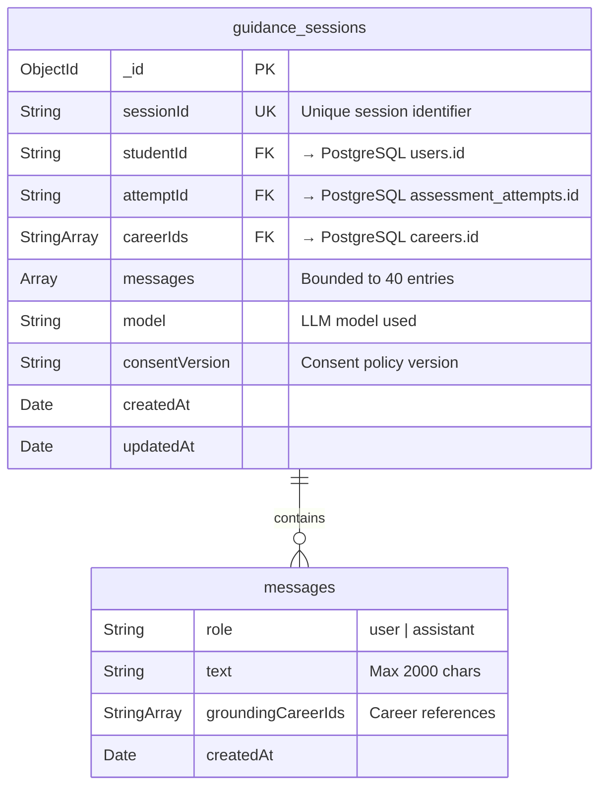
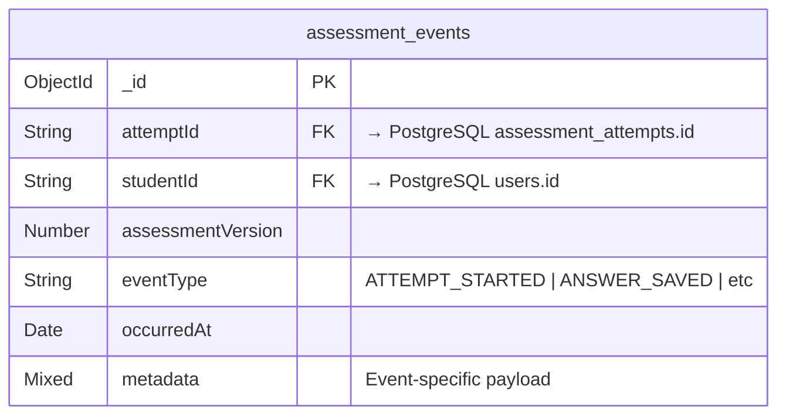
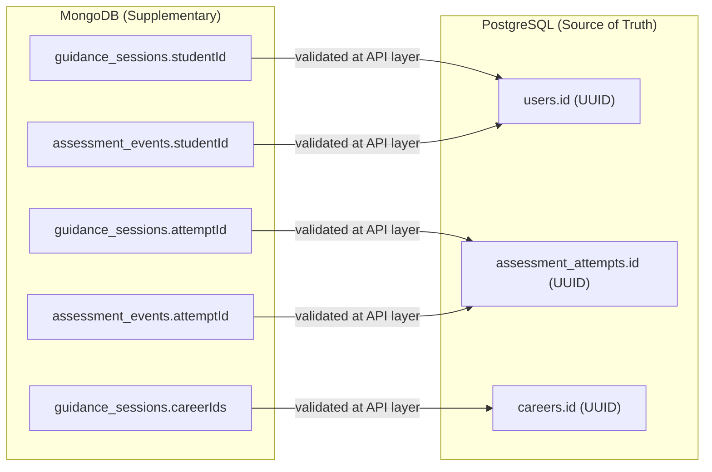

# CareerCompass — Entity-Relationship Diagram

**Status:** Proposed design, not implemented  
**Version:** 1.0 · 11 November 2026  
**Document Owner:** Aradhya Tiwari (Data Engineering Lead)  
**Companion:** `docs/data-model.md` v1.0, `docs/api-contract.md` v1

---

## 1. PostgreSQL ER Diagram

The following Mermaid ER diagram covers all PostgreSQL entities defined in the data model. Primary keys, foreign keys, important unique constraints, and cardinalities are shown.

```mermaid
erDiagram
    User {
        UUID id PK
        VARCHAR email UK "UNIQUE, NOT NULL"
        VARCHAR password_hash "NOT NULL"
        VARCHAR display_name "NOT NULL"
        ENUM role "STUDENT | COUNSELLOR | ADMIN"
        ENUM status "ACTIVE | SUSPENDED"
        TIMESTAMPTZ created_at
        TIMESTAMPTZ updated_at
    }

    StudentProfile {
        UUID user_id PK, FK "FK → users.id"
        VARCHAR school_grade "NULLABLE"
        BOOLEAN consent_accepted "DEFAULT FALSE"
        TIMESTAMPTZ created_at
    }

    CounsellorProfile {
        UUID user_id PK, FK "FK → users.id"
        VARCHAR display_name "NOT NULL"
        TEXT bio "NULLABLE"
        BOOLEAN active "DEFAULT TRUE"
        TIMESTAMPTZ created_at
    }

    RefreshSession {
        UUID id PK
        UUID user_id FK "FK → users.id"
        VARCHAR hashed_token_id "NOT NULL"
        TIMESTAMPTZ expires_at
        TIMESTAMPTZ revoked_at "NULLABLE"
        UUID rotated_from FK "FK → refresh_sessions.id"
        TIMESTAMPTZ created_at
    }

    Assessment {
        UUID id PK
        VARCHAR title "NOT NULL"
        TEXT description "NULLABLE"
        INTEGER version "DEFAULT 1"
        ENUM status "DRAFT | PUBLISHED | ARCHIVED"
        TIMESTAMPTZ created_at
        TIMESTAMPTZ updated_at
    }

    Question {
        UUID id PK
        UUID assessment_id FK "FK → assessments.id"
        ENUM dimension "6 interest dimensions"
        TEXT prompt "NOT NULL"
        INTEGER position "UNIQUE per assessment"
        DECIMAL weight "CHECK > 0"
        JSONB options "Array of id, label, value"
        TIMESTAMPTZ created_at
    }

    AssessmentAttempt {
        UUID id PK
        UUID student_id FK "FK → student_profiles.user_id"
        UUID assessment_id FK "FK → assessments.id"
        INTEGER assessment_version
        ENUM status "IN_PROGRESS | COMPLETED | ABANDONED"
        JSONB scores_json "NULLABLE, set on completion"
        VARCHAR algorithm_version "NULLABLE"
        TIMESTAMPTZ started_at
        TIMESTAMPTZ completed_at "NULLABLE"
    }

    Answer {
        UUID id PK
        UUID attempt_id FK "FK → assessment_attempts.id"
        UUID question_id FK "FK → questions.id"
        VARCHAR selected_option_id "NOT NULL"
        INTEGER score "0..4, server-resolved"
        TIMESTAMPTZ answered_at
    }

    Career {
        UUID id PK
        VARCHAR slug UK "UNIQUE, kebab-case"
        VARCHAR title "NOT NULL, 2..120 chars"
        TEXT description "NULLABLE"
        BOOLEAN published "DEFAULT FALSE"
        TEXT source_note "NULLABLE"
        TIMESTAMPTZ created_at
        TIMESTAMPTZ updated_at
    }

    CareerDimension {
        UUID id PK
        UUID career_id FK "FK → careers.id"
        ENUM dimension "6 interest dimensions"
        DECIMAL target_weight "0..1"
    }

    Skill {
        UUID id PK
        VARCHAR name UK "UNIQUE, NOT NULL"
        TIMESTAMPTZ created_at
    }

    CareerSkill {
        UUID career_id PK, FK "FK → careers.id"
        UUID skill_id PK, FK "FK → skills.id"
    }

    EducationPathway {
        UUID id PK
        UUID career_id FK "FK → careers.id"
        VARCHAR stage "NOT NULL"
        VARCHAR qualification "NOT NULL"
        TEXT notes "NULLABLE"
        TIMESTAMPTZ verified_at "NULLABLE"
        TIMESTAMPTZ created_at
    }

    Recommendation {
        UUID id PK
        UUID attempt_id FK "FK → assessment_attempts.id"
        UUID career_id FK "FK → careers.id"
        INTEGER rank "CHECK >= 1"
        DECIMAL similarity_score "0..1"
        JSONB explanation_json "NULLABLE"
        VARCHAR algorithm_version "NOT NULL"
        TIMESTAMPTZ created_at
    }

    SavedCareer {
        UUID student_id PK, FK "FK → student_profiles.user_id"
        UUID career_id PK, FK "FK → careers.id"
        TIMESTAMPTZ saved_at
    }

    AvailabilitySlot {
        UUID id PK
        UUID counsellor_id FK "FK → counsellor_profiles.user_id"
        TIMESTAMPTZ starts_at "NOT NULL"
        TIMESTAMPTZ ends_at "CHECK > starts_at"
        ENUM status "AVAILABLE | BOOKED | CANCELLED"
        TIMESTAMPTZ created_at
    }

    Booking {
        UUID id PK
        UUID student_id FK "FK → student_profiles.user_id"
        UUID counsellor_id FK "FK → counsellor_profiles.user_id"
        UUID slot_id FK "FK → availability_slots.id; partial UK (active)"
        ENUM status "CONFIRMED | COMPLETED | CANCELLED"
        VARCHAR note "NULLABLE, max 500"
        TIMESTAMPTZ created_at
        TIMESTAMPTZ updated_at
    }

    EmailOutbox {
        UUID id PK
        VARCHAR event_type "NOT NULL"
        JSONB payload "NOT NULL"
        ENUM status "PENDING | SENT | FAILED"
        INTEGER attempts "DEFAULT 0"
        TIMESTAMPTZ next_attempt_at "NULLABLE"
        VARCHAR idempotency_key UK "UNIQUE, NULLABLE"
        TIMESTAMPTZ created_at
    }

    %% === RELATIONSHIPS ===

    %% User profiles (1:0..1)
    User ||--o| StudentProfile : "has profile"
    User ||--o| CounsellorProfile : "has profile"
    User ||--o{ RefreshSession : "has sessions"

    %% Assessment structure
    Assessment ||--o{ Question : "contains"
    Assessment ||--o{ AssessmentAttempt : "attempted via"

    %% Student assessment flow
    StudentProfile ||--o{ AssessmentAttempt : "takes"
    AssessmentAttempt ||--o{ Answer : "records"
    Question ||--o{ Answer : "answered by"

    %% Recommendations
    AssessmentAttempt ||--o{ Recommendation : "generates"
    Career ||--o{ Recommendation : "recommended as"

    %% Career catalogue
    Career ||--o{ CareerDimension : "profiled by"
    Career ||--o{ CareerSkill : "requires"
    Skill ||--o{ CareerSkill : "used in"
    Career ||--o{ EducationPathway : "reached via"

    %% Saved careers
    StudentProfile ||--o{ SavedCareer : "bookmarks"
    Career ||--o{ SavedCareer : "saved by"

    %% Booking system
    CounsellorProfile ||--o{ AvailabilitySlot : "offers"
    AvailabilitySlot ||--o{ Booking : "reserved by (historical; max 1 active)"
    StudentProfile ||--o{ Booking : "requests"
    CounsellorProfile ||--o{ Booking : "assigned to"
```



---

## 2. Uniqueness and Constraint Summary

The ER diagram above uses `UK` annotations. Below is a consolidated list of all uniqueness rules and important constraints:

| Table | Constraint | Type | Purpose |
|---|---|---|---|
| `users` | `email` | UNIQUE | One account per email address |
| `questions` | `(assessment_id, position)` | UNIQUE | No duplicate positions within an assessment |
| `answers` | `(attempt_id, question_id)` | UNIQUE | One answer per question per attempt |
| `career_dimensions` | `(career_id, dimension)` | UNIQUE | One weight per dimension per career |
| `career_skills` | `(career_id, skill_id)` | PK (composite) | No duplicate skill assignments |
| `saved_careers` | `(student_id, career_id)` | PK (composite) | No duplicate saves |
| `careers` | `slug` | UNIQUE | URL-friendly identifier |
| `skills` | `name` | UNIQUE | No duplicate skill names |
| `recommendations` | `(attempt_id, career_id)` | UNIQUE | No duplicate recommendations per attempt |
| `bookings` | `slot_id (partial)` | UNIQUE WHERE status = 'CONFIRMED' | Exactly one active booking per slot while allowing historical cancelled bookings |
| `email_outbox` | `idempotency_key` | UNIQUE | Prevents duplicate email sends |
| `refresh_sessions` | `hashed_token_id` | INDEX | Fast lookup for token validation |

---

## 3. Relationship Cardinalities Explained

### 3.1 One-to-One (1:1) / Scoped 1:1

- **User → StudentProfile / CounsellorProfile:** Each user has at most one profile of each type. A `STUDENT` role user has a `StudentProfile`; a `COUNSELLOR` role user has a `CounsellorProfile`. The profile's PK is the user's FK, enforcing the 1:1 constraint.

- **AvailabilitySlot → Booking (Active):** Each slot can be linked to at most **one active** (`CONFIRMED`) booking at any given time. This is enforced by PostgreSQL's partial unique index `uq_bookings_active_slot` on `(slot_id) WHERE status = 'CONFIRMED'`.

### 3.2 One-to-Many (1:N)

- **AvailabilitySlot → Booking (Historical):** Over time, a single slot may link to multiple booking records (1:N) if a student cancels a booking and another student (or the same student) subsequently rebooks that slot. All historical cancelled bookings remain preserved.
- **User → RefreshSession:** A user may have multiple active or revoked refresh sessions (e.g., from different devices).
- **Assessment → Question:** An assessment contains multiple ordered questions.
- **Assessment → AssessmentAttempt:** An assessment may be attempted by many students over time.
- **StudentProfile → AssessmentAttempt:** A student may take multiple assessments (or retake).
- **AssessmentAttempt → Answer:** An attempt contains one answer per question.
- **AssessmentAttempt → Recommendation:** Submission generates one recommendation per published career.
- **Career → CareerDimension:** Each career has exactly 6 dimension weights (one per dimension).
- **Career → EducationPathway:** A career has multiple educational stages.
- **Career → Recommendation:** A career may appear in many students' recommendations.
- **CounsellorProfile → AvailabilitySlot:** A counsellor publishes multiple future time slots.
- **StudentProfile / CounsellorProfile → Booking:** Students and counsellors can have multiple bookings.

### 3.3 Many-to-Many (M:N)

- **Career ↔ Skill (via CareerSkill):** Careers require multiple skills; skills apply to multiple careers. The `career_skills` join table with composite PK `(career_id, skill_id)` resolves this.

- **StudentProfile ↔ Career (via SavedCareer):** Students can save multiple careers; careers can be saved by multiple students. The `saved_careers` table with composite PK `(student_id, career_id)` resolves this.

---

## 4. Double-Booking Prevention & Concurrency Architecture

The most critical data integrity requirement is preventing two students from booking the same counsellor slot simultaneously, while permitting cancelled slots to be rebooked without losing historical records. This is enforced through **three complementary layers**:

### 4.1 Database-Level Safeguard: Partial Unique Index

A naive `UNIQUE(slot_id)` constraint would prevent any cancelled slot from ever being rebooked, because the cancelled booking row would still hold that `slot_id`. We solve this by defining a **partial unique index** in PostgreSQL:

```sql
-- Guarantees at most ONE active (CONFIRMED) booking per slot at any time.
-- Cancelled bookings remain in the table for history and auditing without blocking rebooking.
CREATE UNIQUE INDEX uq_bookings_active_slot
ON bookings (slot_id)
WHERE status = 'CONFIRMED';
```

Even if application logic fails or transaction isolation is misconfigured, the PostgreSQL engine will reject any concurrent attempt to insert a second `CONFIRMED` booking for the same slot with a unique violation (`23505`), which the service layer catches and maps to `409 Conflict (SLOT_UNAVAILABLE)`.

### 4.2 Application Concurrency Strategies: Atomic Update & Row Locking

To prevent race conditions before reaching database constraint failures, the application implements atomic state transitions:

**Strategy A — Atomic Conditional Update (Recommended for ORMs):**
```sql
BEGIN;
  -- Executes atomically in PostgreSQL, acquiring an exclusive lock on the matching row:
  UPDATE availability_slots
  SET status = 'BOOKED'
  WHERE id = :slotId AND status = 'AVAILABLE';

  -- If zero rows updated, another concurrent transaction has already claimed this slot:
  -- Application checks affectedRows == 0 -> ROLLBACK and return 409 Conflict

  INSERT INTO bookings (id, student_id, counsellor_id, slot_id, status, note)
  VALUES (gen_random_uuid(), :studentId, :counsellorId, :slotId, 'CONFIRMED', :note);

  INSERT INTO email_outbox (id, event_type, payload, idempotency_key)
  VALUES (gen_random_uuid(), 'BOOKING_CONFIRMED', :payload, :idempotencyKey);
COMMIT;
```

**Strategy B — Explicit Row-Level Locking (`SELECT ... FOR UPDATE`):**
```sql
BEGIN;
  -- Step 1: Acquire an exclusive row lock on the target slot
  SELECT id, counsellor_id, status
  FROM availability_slots
  WHERE id = :slotId AND status = 'AVAILABLE'
  FOR UPDATE;

  -- If no row returned -> slot already booked or doesn't exist
  -- ROLLBACK and return 409 SLOT_UNAVAILABLE

  -- Step 2: Atomically mark the slot as booked
  UPDATE availability_slots
  SET status = 'BOOKED'
  WHERE id = :slotId;

  -- Step 3: Create the booking record
  INSERT INTO bookings (id, student_id, counsellor_id, slot_id, status, note)
  VALUES (gen_random_uuid(), :studentId, :counsellorId, :slotId, 'CONFIRMED', :note);

  -- Step 4: Queue email notification
  INSERT INTO email_outbox (id, event_type, payload, idempotency_key)
  VALUES (gen_random_uuid(), 'BOOKING_CONFIRMED', :payload, :idempotencyKey);
COMMIT;
```

**How concurrency is handled during a race:**
1. **Student A** executes the atomic update or `SELECT ... FOR UPDATE` on slot `X`. PostgreSQL grants the row lock to Student A.
2. **Student B** attempts to execute the same query on slot `X`. PostgreSQL **blocks** Student B until Student A's transaction completes.
3. **Student A** updates the slot to `BOOKED`, inserts the booking, and commits. The lock is released.
4. **Student B's** query resumes. Because the slot status is now `'BOOKED'`, the predicate `WHERE status = 'AVAILABLE'` fails to match, returning 0 rows.
5. Student B's service layer detects the empty update, executes a rollback, and immediately returns `409 Conflict (SLOT_UNAVAILABLE)` with an informative client message.

### 4.3 Idempotency Key (Optional)

The API contract supports an optional `Idempotency-Key` header (UUID, scoped to user + route, retained 24 hours). If a client retries a booking request with the same key, the server returns the original booking result instead of creating a duplicate.

### 4.4 Cancellation Atomicity and Rebooking Consistency

Booking cancellation runs in an atomic transaction that preserves booking history while freeing the slot for rebooking:

```sql
BEGIN;
  -- Lock and verify that an active CONFIRMED booking exists for the student
  SELECT id, slot_id, status
  FROM bookings
  WHERE id = :bookingId AND student_id = :studentId AND status = 'CONFIRMED'
  FOR UPDATE;

  -- Transition booking status to CANCELLED (row remains in table for audit/metrics)
  UPDATE bookings SET status = 'CANCELLED', updated_at = NOW()
  WHERE id = :bookingId;

  -- Reset slot status to AVAILABLE
  UPDATE availability_slots SET status = 'AVAILABLE'
  WHERE id = :slotId;

  INSERT INTO email_outbox (id, event_type, payload, idempotency_key)
  VALUES (gen_random_uuid(), 'BOOKING_CANCELLED', :payload, :idempotencyKey);
COMMIT;
```

**Why Rebooking Works:**
Because the partial index only enforces uniqueness where `status = 'CONFIRMED'`, setting the existing booking to `'CANCELLED'` removes it from the partial index restriction. The slot is marked `'AVAILABLE'`, allowing another student to book the slot later. When rebooked, a new `CONFIRMED` booking is inserted, preserving both the cancelled and new bookings in the database.

---

## 5. MongoDB Document Model (Supplementary)

MongoDB stores two supplementary collections. These are **not authoritative** for scoring, authorization, or booking state. See `docs/data-model.md` §6 for full schemas.

### 5.1 `guidance_sessions` — AI Conversation History



**Indexes:**
- `{ sessionId: 1 }` — unique
- `{ studentId: 1, updatedAt: -1 }` — compound, for student session listing

### 5.2 `assessment_events` — Diagnostic Event Log



**Indexes:**
- `{ attemptId: 1, occurredAt: 1 }` — compound, for attempt timeline
- `{ studentId: 1, occurredAt: -1 }` — compound, for student activity

---

## 6. Cross-Database Reference Diagram

The following diagram shows how MongoDB documents reference PostgreSQL entities via string UUIDs. Referential integrity is enforced at the application/service layer, not by database-level foreign keys.



**Rule:** Always validate that referenced PostgreSQL records exist and belong to the authenticated user **before** writing to MongoDB. A MongoDB write failure does not roll back the PostgreSQL transaction.

---

## 7. Consistency with API Contract

The ER diagram entities map directly to the REST API resources defined in `docs/api-contract.md`:

| API Resource | PostgreSQL Entity | Notes |
|---|---|---|
| `POST /auth/register` | `User`, `StudentProfile` | Creates both atomically |
| `GET /users/me` | `User`, `StudentProfile` or `CounsellorProfile` | JOIN on role |
| `GET /assessments` | `Assessment` | Filtered by status |
| `GET /assessments/:id/questions` | `Question` | Filtered by assessment; values hidden from students |
| `POST /assessments/:id/attempts` | `AssessmentAttempt` | Creates IN_PROGRESS attempt |
| `PUT /attempts/:id/answers/:questionId` | `Answer` | Upsert via UNIQUE(attempt_id, question_id) |
| `POST /attempts/:id/submit` | `AssessmentAttempt`, `Recommendation` | Transaction: update attempt + insert recommendations |
| `GET /attempts/:id/recommendations` | `Recommendation` JOIN `Career` | Ranked list |
| `GET /careers` | `Career` | Paginated, filtered, sorted |
| `GET /careers/:idOrSlug` | `Career` JOIN `CareerDimension`, `CareerSkill`/`Skill`, `EducationPathway` | Full detail |
| `PUT /users/me/saved-careers/:careerId` | `SavedCareer` | Idempotent upsert |
| `GET /counsellors/:id/slots` | `AvailabilitySlot` | Filtered by date range |
| `POST /bookings` | `Booking`, `AvailabilitySlot`, `EmailOutbox` | Transaction with FOR UPDATE |
| `POST /guidance/sessions` | MongoDB `guidance_sessions` | After SQL validation |
| `POST /guidance/sessions/:id/messages` | MongoDB `guidance_sessions` (message append) | After SQL data fetch |

> [!NOTE]
> **Open item:** The API contract (§7) references `GET /counsellors/me/slots` in the UI specification route mapping, but this endpoint is not formally defined in the API contract table. It should be added for counsellor self-management of slots. See `docs/data-model.md` §9, item #2.

