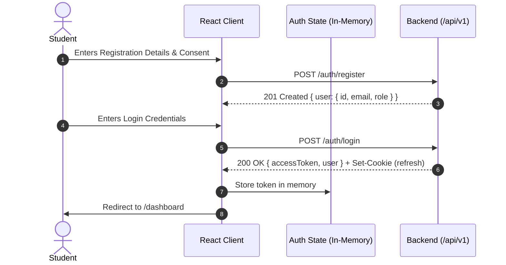
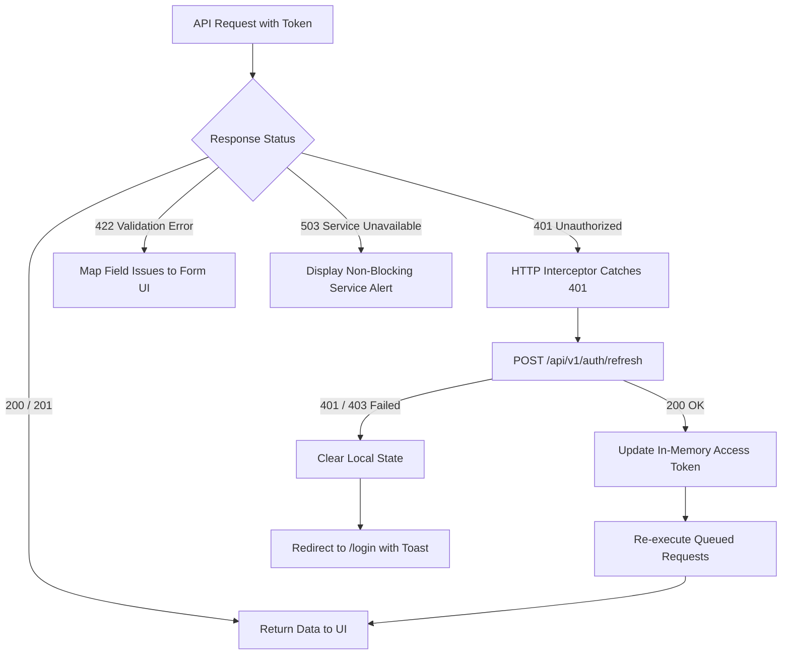

# CareerCompass — Frontend UI/UX Specification

**Status:** Authoritative Design Specification  
**Version:** 1.0 · 11 November 2026  
**Document Owner:** Dhavika Bika (ISD Lead & Frontend Architect)  
**Stakeholder Framework:** Ministry of Education • Samagra Shiksha Abhiyan • NEP 2020  
**Implementation Target:** React 18 + Vite Frontend Application  

---

## 1. Executive Summary & Architectural Scope

CareerCompass is an integrated, school-oriented career guidance platform designed to empower secondary and higher secondary students (Grades 9–12) to make informed, data-backed career decisions. 

In alignment with **`docs/architecture.md`** and **`docs/api-contract.md`**, this document formalizes the frontend architecture, complete user journeys, routing topology, design system tokens, component hierarchies, state management patterns, error resilience strategies, and mapping to the 15-mark College ISD Rubric.

### Core Architectural Boundaries
1. **Decoupled Client:** The React/Vite web application operates strictly as a consumer of the `/api/v1` REST backend. It contains **zero direct database connections** (no direct Prisma/PostgreSQL or Mongoose/MongoDB drivers).
2. **Authoritative Contracts:** All frontend actions, payloads, and state transformations strictly adhere to the contracts defined by Divy (Backend Lead) in `docs/api-contract.md`.
3. **No Algorithmic Scoring on Client:** Assessment scoring and cosine similarity matching are performed exclusively on the backend server. The client visualizes dimension vectors and similarity scores without calculating raw rankings.
4. **School Student Usability:** The interface avoids clinical or psychometric jargon. Cosine similarity is presented as an alignment score (0–100%), not a deterministic probability of career success.

---

## 2. Complete User Journeys

### Journey 1: Student Registration & Authentication
- **Entry & Intent:** A secondary school student arrives at the platform seeking guidance.
- **Flow:**
  1. Student accesses `/register`.
  2. The form requests `displayName`, `email`, `password` (minimum 12 characters), optional `schoolGrade` (dropdown: "9th", "10th", "11th", "12th"), and a mandatory guardian/school policy `consentAccepted` checkbox.
  3. Client validates format using a Zod schema before submission.
  4. On valid submit, calls `POST /api/v1/auth/register`. On `201 Created`, the user is automatically transitioned to `/login` with a success toast.
  5. On `/login`, the student enters credentials. Submitting calls `POST /api/v1/auth/login`.
  6. On `200 OK`, the server sets an `HttpOnly`, `Secure` refresh cookie and returns `{ data: { accessToken, expiresIn, user } }`.
  7. Client stores the `accessToken` in memory (React Auth Context/Zustand), attaches user details, and routes the student to `/dashboard`.



### Journey 2: Student Dashboard
- **Role:** `STUDENT`
- **Route:** `/dashboard`
- **Flow:**
  1. On mount, client fetches current user profile (`GET /api/v1/users/me`), historical attempts (`GET /api/v1/attempts?limit=5&sort=startedAt&order=desc`), bookmarked careers (`GET /api/v1/users/me/saved-careers?limit=5`), and active bookings (`GET /api/v1/bookings?limit=3&sort=startsAt&order=asc`).
  2. **Empty State:** If the student has never taken an assessment, a prominent "Welcome Assessment Card" invites them to start their first exploration with an estimated time (~7 minutes).
  3. **Active/Completed State:** Displays:
     - Profile badge with student name, grade, and verification status.
     - Latest Assessment Radar Summary (visualizing 6 interest dimensions).
     - Top Matched Career teaser card with quick link to `/attempts/:id/recommendations`.
     - Upcoming counsellor appointment card (with status badge: `CONFIRMED`).
     - Quick shortcut buttons to Career Explorer (`/careers`) and AI Explanations.

### Journey 3: Assessment Flow
- **Role:** `STUDENT`
- **Route:** `/assessments/:id/take`
- **Flow:**
  1. Student initiates or resumes an assessment attempt via `POST /api/v1/assessments/:id/attempts` (or retrieves `IN_PROGRESS` attempt from `GET /api/v1/attempts`).
  2. Client fetches assessment questions via `GET /api/v1/assessments/:id/questions`. Notice: questions contain options with text labels and unique `optionId`s, but **no scoring weights or values** (maintaining assessment integrity).
  3. **Question Presentation:** The question bank is presented in a distraction-free, accessible questionnaire wizard. Questions display dimension badges (e.g., `ANALYTICAL`, `CREATIVE`) and scenario context.
  4. **Answer Saving:** As the student selects an option, the client optimistically updates local UI and dispatches an idempotent `PUT /api/v1/attempts/:id/answers/:questionId` with `{ optionId }`.
  5. **Auto-Save & Palette:** A 30-question status drawer shows Answered (green), Current (focused), and Unanswered (muted) states. Progress bar updates dynamically.
  6. **Review Step:** Before submission, client verifies that all required questions have answers. If questions are missing, the review step highlights unanswered items and disables the final submit button.
  7. **Submission:** Student clicks "Submit Assessment". A modal confirms submission. Client executes `POST /api/v1/attempts/:id/submit`.
  8. Server validates and processes scoring atomically. On `200 OK`, server returns `{ data: { attemptId, status: "COMPLETED", dimensionScores, recommendationsUrl } }`. Client immediately transitions to `/attempts/:id/results`.

### Journey 4: Assessment Results & Dimension Profile
- **Role:** `STUDENT`
- **Route:** `/attempts/:id/results`
- **Flow:**
  1. Client queries `GET /api/v1/attempts/:id` to obtain finalized dimension scores (`ANALYTICAL`, `CREATIVE`, `SOCIAL`, `PRACTICAL`, `ORGANIZATIONAL`, `INVESTIGATIVE`).
  2. Renders an interactive 6-axis **Spider/Radar Chart** alongside horizontal percentage progress meters.
  3. Clear, supportive text explains each dimension in student-friendly terminology (e.g., "Analytical: Enjoying logic, patterns, and mathematical problem solving").
  4. Explicit disclaimer badge: *"These scores reflect your expressed interests and self-reported preferences, not an aptitude test or psychological certification."*
  5. Primary Call-to-Action button: *"View Career Recommendations →"* routes to `/attempts/:id/recommendations`.

### Journey 5: Career Recommendations
- **Role:** `STUDENT`
- **Route:** `/attempts/:id/recommendations`
- **Flow:**
  1. Client executes `GET /api/v1/attempts/:id/recommendations?page=1&limit=20`.
  2. Server returns ranked careers sorted deterministically (similarity score descending, then slug ascending).
  3. Each recommendation card presents:
     - Numerical Rank badge (#1, #2, #3).
     - Career title and category domain.
     - **Similarity Score:** Expressed as a percentage badge (e.g., `92% Alignment`).
     - Clear label: *"Vector Alignment Score (Cosine Similarity)"*.
     - Structured `reasons` list (e.g., *"Strong alignment with analytical and investigative interests"*).
     - Structured `cautions` callout (e.g., *"Requires significant desk research; explore day-to-day workflow"*).
     - Bookmark button (calls `PUT /api/v1/users/me/saved-careers/:careerId`).
     - *"Explain with AI"* button (opens AI Guidance drawer initialized with this career and attempt ID).
     - *"View Full Blueprint"* button (routes to `/careers/:slug`).

### Journey 6: Career Explorer Directory
- **Role:** `PUBLIC` / `STUDENT`
- **Route:** `/careers`
- **Flow:**
  1. Student or guest browses published careers via `GET /api/v1/careers?page=1&limit=20`.
  2. Includes responsive search bar with real-time debounce for query param `q`.
  3. Filters: Discipline/Stream dropdown (`STEM`, `Commerce`, `Humanities`, `Design`, `Vocational`), Skill filter (`skillId`), and Sort order (`title` asc/desc, `createdAt` desc).
  4. View toggle: "All Careers" vs. "My Saved Careers" (switches data source to `GET /api/v1/users/me/saved-careers` when authenticated).
  5. Pagination controls (`page`, `limit`, `totalPages`, `total`) adhere to standardized `{ data, meta }` response envelope.

### Journey 7: Career Detail Blueprint
- **Role:** `PUBLIC` / `STUDENT`
- **Route:** `/careers/:idOrSlug`
- **Flow:**
  1. Client calls `GET /api/v1/careers/:idOrSlug`.
  2. Detail page renders:
     - Header with title, slug, verified publication badge, and average entry salary benchmarks (in INR LPA).
     - Summary description and daily responsibilities.
     - **Verified Educational Pathways (`GET /api/v1/careers/:id/pathways`):** Chronological stages (Secondary School → Undergraduate Degree → Postgraduate / Specialization) with entry exams (JEE, NEET, CUET, CLAT, NID, etc.) and verified institutions.
     - **Required Skills:** Tag list linked to related career clusters.
     - **Dimension Comparison:** Compares career's target dimension weights against the authenticated student's scores (if an assessment exists).
     - Action bar: "Bookmark Career", "Book Counsellor Discussion", "Ask MargDarshak AI".

### Journey 8: Counsellor Session Booking
- **Role:** `STUDENT`
- **Route:** `/counsellors` and `/counsellors/:id/book`
- **Flow:**
  1. Student browses active, verified school counsellors via `GET /api/v1/counsellors`.
  2. Student selects a counsellor and views their profile (`GET /api/v1/counsellors/:id`) and upcoming availability slots (`GET /api/v1/counsellors/:id/slots?from=...&to=...`).
  3. Student selects an available time slot.
  4. Enters an optional discussion note (max 500 characters, client validates absence of confidential passwords/PII).
  5. Student submits booking via `POST /api/v1/bookings` with `{ slotId, note }`.
  6. **Concurrency Resilience:**
     - If slot is acquired: `201 Created` with booking status `CONFIRMED` and `notificationStatus: "PENDING"`. A calendar invite action appears.
     - If another student booked the slot concurrently: Server returns `409 Conflict (SLOT_UNAVAILABLE)`. Client displays an immediate error notification: *"This slot was just reserved by another student. Please select an alternate time."* and refreshes the slot list.

### Journey 9: Counsellor Workspace
- **Role:** `COUNSELLOR`
- **Route:** `/counsellor/dashboard` and `/counsellor/slots`
- **Flow:**
  1. Counsellor logs in and is directed to their dedicated workspace.
  2. **Assigned Bookings:** Queries `GET /api/v1/bookings` (filtered by counsellor ownership on server). Displays cards with student display name, booked time (UTC converted to school local time), and student discussion note.
  3. **Status Transitions:** Counsellor can update permitted status via `PATCH /api/v1/bookings/:id/status` (e.g., mark `COMPLETED` after the session or `CANCELLED`).
  4. **Availability Management (`/counsellor/slots`):**
     - Counsellor views existing calendar slots.
     - Creates new future slot via `POST /api/v1/counsellors/me/slots` with `{ startsAt, endsAt }`.
     - Deletes unbooked slots via `DELETE /api/v1/counsellors/me/slots/:id`. (Booked slots return `409 Conflict` and cannot be deleted).

### Journey 10: Admin Control Center & Analytics
- **Role:** `ADMIN`
- **Route:** `/admin/dashboard`, `/admin/careers`, `/admin/users`
- **Flow:**
  1. Admin logs in; middleware confirms `role === 'ADMIN'`.
  2. **Analytics Overview (`/admin/dashboard`):** Calls `GET /api/v1/analytics/overview` and `GET /api/v1/analytics/career-interests`.
     - Shows privacy-preserving aggregate metrics: total completed assessments, top interest dimensions, booking utilization rates, and career save frequencies.
     - **k-Anonymity Suppression:** If any cohort/dimension has fewer than $k=5$ student records, the UI displays `< 5 (Suppressed for Student Privacy)` ensuring individual student tracking is impossible.
  3. **Catalogue Management (`/admin/careers`):** Lists all careers including drafts. Allows creating new careers (`POST /api/v1/careers`), updating metadata (`PATCH /api/v1/careers/:id`), and managing pathways.
  4. **User Administration (`/admin/users`):** Lists registered accounts with role filters and pagination. Allows toggling status between `ACTIVE` and `SUSPENDED` via `PATCH /api/v1/admin/users/:id/status`.

---

## 3. Application Route Matrix

| Route Path | Allowed Roles | Page Title & Purpose | Associated Backend API Endpoints |
|---|---|---|---|
| `/` | `PUBLIC` | Landing Page & Overview | None (static client assets) |
| `/login` | `PUBLIC` | Student & Staff Login | `POST /api/v1/auth/login` |
| `/register` | `PUBLIC` | Student Registration | `POST /api/v1/auth/register` |
| `/dashboard` | `STUDENT` | Student Personal Hub | `GET /api/v1/users/me`, `GET /api/v1/attempts`, `GET /api/v1/bookings`, `GET /api/v1/users/me/saved-careers` |
| `/assessments` | `STUDENT` | Assessments Directory | `GET /api/v1/assessments` |
| `/assessments/:id/take` | `STUDENT` | Interactive Assessment Runner | `POST /api/v1/assessments/:id/attempts`, `GET /api/v1/assessments/:id/questions`, `PUT /api/v1/attempts/:id/answers/:questionId`, `POST /api/v1/attempts/:id/submit` |
| `/attempts/:id/results` | `STUDENT` | Psychometric Profile & Radar | `GET /api/v1/attempts/:id` |
| `/attempts/:id/recommendations` | `STUDENT` | Ranked Career Recommendations | `GET /api/v1/attempts/:id/recommendations`, `PUT/DELETE /api/v1/users/me/saved-careers/:careerId` |
| `/careers` | `PUBLIC`, `STUDENT` | Career Explorer Directory | `GET /api/v1/careers`, `GET /api/v1/skills`, `GET /api/v1/users/me/saved-careers` |
| `/careers/:idOrSlug` | `PUBLIC`, `STUDENT` | Career Detail & Pathway Blueprint | `GET /api/v1/careers/:idOrSlug`, `GET /api/v1/careers/:id/pathways`, `PUT/DELETE /api/v1/users/me/saved-careers/:careerId` |
| `/counsellors` | `STUDENT` | Counsellor Directory | `GET /api/v1/counsellors` |
| `/counsellors/:id/book` | `STUDENT` | Slot Booking Modal/Page | `GET /api/v1/counsellors/:id`, `GET /api/v1/counsellors/:id/slots`, `POST /api/v1/bookings` |
| `/bookings` | `STUDENT` | My Scheduled Appointments | `GET /api/v1/bookings`, `PATCH /api/v1/bookings/:id/status` |
| `/guidance` | `STUDENT` | MargDarshak AI Sessions Hub | `GET /api/v1/guidance/sessions`, `POST /api/v1/guidance/sessions`, `DELETE /api/v1/guidance/sessions/:id` |
| `/guidance/:sessionId` | `STUDENT` | AI Guidance Interactive Chat | `GET /api/v1/guidance/sessions/:id`, `POST /api/v1/guidance/sessions/:id/messages` |
| `/counsellor/dashboard` | `COUNSELLOR` | Counsellor Appointments Hub | `GET /api/v1/bookings`, `PATCH /api/v1/bookings/:id/status` |
| `/counsellor/slots` | `COUNSELLOR` | Slot Availability Management | `GET /api/v1/counsellors/me/slots`, `POST /api/v1/counsellors/me/slots`, `DELETE /api/v1/counsellors/me/slots/:id` |
| `/admin/dashboard` | `ADMIN` | Administrative Analytics Hub | `GET /api/v1/analytics/overview`, `GET /api/v1/analytics/career-interests` |
| `/admin/careers` | `ADMIN` | Career Catalogue Management | `GET /api/v1/careers`, `POST /api/v1/careers`, `PATCH /api/v1/careers/:id`, `DELETE /api/v1/careers/:id` |
| `/admin/users` | `ADMIN` | User Role & Status Directory | `GET /api/v1/admin/users`, `PATCH /api/v1/admin/users/:id/status` |
| `/403` | `PUBLIC` | Unauthorized Access Screen | None |
| `*` | `PUBLIC` | 404 Not Found Screen | None |

### Route Protection Strategy
- **`ProtectedRoute` Component:** Verifies that an active JWT exists in memory. If not, captures `location.pathname` and redirects to `/login?redirect=${encodeURIComponent(pathname)}`.
- **`RoleGuard` Component:** Checks `user.role` against allowlisted roles. If a student attempts to navigate to `/admin/dashboard`, the component immediately halts rendering and directs to `/403 Forbidden` without leaking admin UI metadata.

---

## 4. Component Hierarchy & Modular Architecture

```text
src/
├── app/
│   ├── routes.tsx                    # React Router 6 configuration
│   └── App.tsx                       # Context providers & ErrorBoundary
├── assets/                           # Static SVGs, icons, logos
├── components/
│   ├── layout/
│   │   ├── Header.tsx                # MoE Strip + Main Navigation
│   │   ├── Sidebar.tsx               # Role-based dashboard drawer
│   │   ├── Footer.tsx                # Government disclaimer & policy links
│   │   ├── Breadcrumbs.tsx           # Accessible hierarchical pathing
│   │   └── AppLayout.tsx             # Responsive grid container
│   ├── shared/
│   │   ├── Button.tsx                # Primary, secondary, outline, danger states
│   │   ├── InputField.tsx            # Form input with inline validation
│   │   ├── SelectField.tsx           # Accessible dropdown selector
│   │   ├── Checkbox.tsx              # Focusable consent checkbox
│   │   ├── Modal.tsx                 # Focus-trapped dialog with backdrop
│   │   ├── Toast.tsx                 # Non-intrusive alert notification
│   │   ├── SkeletonLoader.tsx        # Content placeholder animation
│   │   ├── EmptyState.tsx            # Contextual empty state with action
│   │   └── ErrorFallback.tsx         # Boundary error recovery card
│   ├── assessment/
│   │   ├── QuestionCard.tsx          # Scenario, prompt, dimension badge
│   │   ├── OptionItem.tsx            # Clickable option with radio indicator
│   │   ├── QuestionPalette.tsx       # 30-question numbered status bubbles
│   │   ├── AssessmentProgress.tsx    # Live percentage bar and timer
│   │   └── SubmitReviewModal.tsx     # Required answer validation summary
│   ├── recommendations/
│   │   ├── RadarChart.tsx            # Native HTML5 Canvas 6-axis spider plot
│   │   ├── DimensionMeter.tsx        # Horizontal bar with percentage label
│   │   ├── RecommendationCard.tsx    # Rank, title, alignment score, reasons
│   │   └── CautionCallout.tsx        # Explanatory limitation banner
│   ├── careers/
│   │   ├── CareerGrid.tsx            # Responsive card listing
│   │   ├── CareerFilterBar.tsx       # Search query, stream chips, sort select
│   │   ├── PathwayTimeline.tsx       # Education stages & entrance roadmap
│   │   └── BookmarkButton.tsx        # Optimistic toggle star button
│   ├── booking/
│   │   ├── CounsellorCard.tsx        # Bio, credentials, languages, action
│   │   ├── SlotGrid.tsx              # Available date/time pill selector
│   │   ├── BookingModal.tsx          # Slot confirmation & note input
│   │   └── BookingStatusBadge.tsx    # CONFIRMED / COMPLETED / CANCELLED tags
│   ├── guidance/
│   │   ├── GuidanceDrawer.tsx        # Side drawer chat container
│   │   ├── ChatMessageList.tsx       # Scrollable message transcript
│   │   ├── MessageBubble.tsx         # User vs AI message with citation tags
│   │   ├── PromptChipGroup.tsx       # Suggested school-oriented prompts
│   │   └── GroundingBadge.tsx        # Verifiable career reference indicator
│   └── analytics/
│       ├── StatMetricCard.tsx        # Big number, label, delta indicator
│       ├── InterestBarChart.tsx      # Aggregate distribution visualization
│       └── PrivacyNotice.tsx         # Minimum group k-suppression note
├── context/
│   ├── AuthContext.tsx               # JWT, user profile, login, logout, refresh
│   └── ThemeContext.tsx              # Dark/Light mode tokens
├── hooks/
│   ├── useAuth.ts                    # Auth state hook
│   ├── useDebounce.ts                # Real-time search throttling
│   └── useApiQuery.ts                # Fetch wrapper with abort controllers
├── services/
│   └── api/
│       ├── client.ts                 # Axios / Fetch client with 401 interceptor
│       ├── auth.api.ts               # Login, register, refresh, logout
│       ├── assessment.api.ts         # Assessments, attempts, answers, submit
│       ├── careers.api.ts            # Careers, pathways, skills, bookmarks
│       ├── booking.api.ts            # Counsellors, slots, bookings
│       └── guidance.api.ts           # AI sessions and messages
└── types/
    ├── api.d.ts                      # Envelope and error schemas
    ├── models.d.ts                   # User, Career, Attempt, Booking types
    └── dimensions.d.ts               # Fixed dimension enum
```

---

## 5. Design System Specifications

### A. Typography
- **Primary Body Font:** `'Plus Jakarta Sans', system-ui, -apple-system, sans-serif`
- **Display & Headings Font:** `'Outfit', sans-serif`
- **Scale:**
  - `Hero Display`: 40px (2.5rem), line-height 1.2, weight 800
  - `H1 / Page Title`: 32px (2.0rem), line-height 1.25, weight 700
  - `H2 / Section Title`: 24px (1.5rem), line-height 1.3, weight 700
  - `H3 / Card Title`: 18px (1.125rem), line-height 1.4, weight 600
  - `Body Regular`: 15px (0.9375rem), line-height 1.6, weight 400
  - `Body Medium`: 15px (0.9375rem), line-height 1.6, weight 500
  - `Caption / Meta`: 13px (0.8125rem), line-height 1.5, weight 500
  - `Badge / Pill`: 11px (0.6875rem), line-height 1.4, weight 700, uppercase

### B. Color Palette & Theming
Built with CSS Custom Properties supporting High-Contrast Dark and Clean Light modes:

| Semantic Token | Dark Mode Value | Light Mode Value | Purpose |
|---|---|---|---|
| `--bg-base` | `#090d16` (Deep Obsidian) | `#f8fafc` (Slate Light) | Page background |
| `--bg-surface` | `#111827` (Card Charcoal) | `#ffffff` (Pure White) | Card and modal surface |
| `--bg-glass` | `rgba(18, 26, 47, 0.75)` | `rgba(255, 255, 255, 0.85)` | Glassmorphic containers |
| `--border-subtle`| `rgba(255, 255, 255, 0.08)`| `rgba(15, 23, 42, 0.08)` | Dividers, card borders |
| `--border-focus` | `#6366f1` (Indigo Glow) | `#4f46e5` (Deep Indigo) | Focus rings and active borders |
| `--primary` | `#6366f1` | `#4f46e5` | Primary CTA, links, headers |
| `--primary-gradient`| `linear-gradient(135deg, #6366f1, #8b5cf6)` | `linear-gradient(135deg, #4f46e5, #7c3aed)` | Brand highlights |
| `--secondary` | `#06b6d4` (Cyan) | `#0891b2` (Dark Cyan) | Pathway badges, sub-headers |
| `--accent-pink` | `#ec4899` | `#db2777` | Creative dimension tag |
| `--success` | `#10b981` (Emerald) | `#059669` (Dark Emerald) | High match, confirmed slots |
| `--warning` | `#f59e0b` (Amber) | `#d97706` (Dark Amber) | Caution callouts, pending |
| `--danger` | `#ef4444` (Rose Red) | `#dc2626` (Red) | Errors, validation failures |
| `--text-main` | `#f8fafc` | `#0f172a` | Primary readability text |
| `--text-muted` | `#94a3b8` | `#475569` | Secondary captions, notes |
| `--text-dim` | `#64748b` | `#94a3b8` | Placeholders, inactive state |

### C. Dimension Color Coding
To help school students visually parse assessment results without confusion:
- **`ANALYTICAL`**: Royal Indigo (`#6366f1`)
- **`CREATIVE`**: Magenta Pink (`#ec4899`)
- **`SOCIAL`**: Emerald Green (`#10b981`)
- **`PRACTICAL`**: Amber Gold (`#f59e0b`)
- **`ORGANIZATIONAL`**: Cyan Blue (`#06b6d4`)
- **`INVESTIGATIVE`**: Deep Violet (`#8b5cf6`)

### D. Spacing & Responsive Grid
- **Base Unit:** 4px grid (`4px`, `8px`, `12px`, `16px`, `24px`, `32px`, `48px`, `64px`).
- **Breakpoints:**
  - Mobile: `< 640px` (single column layout, stacked tables, bottom-docked navigation).
  - Tablet: `640px – 1023px` (dual column grids, collapsible sidebar).
  - Desktop: `1024px – 1440px` (fixed 1240px container, multi-column dashboard).
  - Wide Display: `> 1440px` (centered layout with maximum content width constraints).

### E. Accessibility Rules (WCAG 2.1 Level AA)
1. **Contrast Ratio:** Text-to-background contrast ratio maintained at $\ge 4.5:1$ for normal body text and $\ge 3:1$ for large headings and icons.
2. **Keyboard Navigability:** Full keyboard access (Tab, Shift+Tab, Enter, Space, Arrow keys). Focused interactive items display a mandatory outline (`2px solid var(--border-focus)` with `2px offset`).
3. **Screen Reader Landmarks:** Proper HTML5 semantic tags (`<header>`, `<main>`, `<nav>`, `<aside>`, `<footer>`, `<section role="region">`).
4. **Form Labels:** Every `<input>` and `<select>` is explicitly tied to an `<label id="...">` with aria-describedby pointing to error containers.

---

## 6. Frontend-to-Backend API Mapping

Every frontend screen strictly maps to endpoints established in `docs/api-contract.md`:

```text
[Frontend View / Action]                 [Backend API Endpoint]
--------------------------------------------------------------------------------------
Register Form Submission             --> POST   /api/v1/auth/register
Login Form Submission                --> POST   /api/v1/auth/login
Session Refresh on 401               --> POST   /api/v1/auth/refresh
Logout Button Click                  --> POST   /api/v1/auth/logout
Dashboard User Profile Query         --> GET    /api/v1/users/me
Assessment Directory Load            --> GET    /api/v1/assessments
Start New Assessment Attempt         --> POST   /api/v1/assessments/:id/attempts
Fetch Assessment Question Bank       --> GET    /api/v1/assessments/:id/questions
Record Question Answer               --> PUT    /api/v1/attempts/:id/answers/:questionId
Submit Completed Assessment          --> POST   /api/v1/attempts/:id/submit
View Finalized Scores & Radar        --> GET    /api/v1/attempts/:id
View Algorithmic Recommendations     --> GET    /api/v1/attempts/:id/recommendations
Toggle Bookmark Career (Add)         --> PUT    /api/v1/users/me/saved-careers/:careerId
Toggle Bookmark Career (Remove)      --> DELETE /api/v1/users/me/saved-careers/:careerId
List Student Saved Careers           --> GET    /api/v1/users/me/saved-careers
Career Explorer Search & Filtering   --> GET    /api/v1/careers
Career Blueprint & Pathways View     --> GET    /api/v1/careers/:idOrSlug
Browse Verified Counsellors          --> GET    /api/v1/counsellors
Fetch Counsellor Future Slots        --> GET    /api/v1/counsellors/:id/slots
Confirm Slot Booking                 --> POST   /api/v1/bookings
View Student Active Bookings         --> GET    /api/v1/bookings
Cancel Student Booking               --> PATCH  /api/v1/bookings/:id/status
Create AI Guidance Session           --> POST   /api/v1/guidance/sessions
Fetch Student Guidance History       --> GET    /api/v1/guidance/sessions
Query AI MargDarshak Chat            --> POST   /api/v1/guidance/sessions/:id/messages
Delete AI Guidance Session           --> DELETE /api/v1/guidance/sessions/:id
Counsellor Availability Slots        --> GET    /api/v1/counsellors/me/slots
Counsellor Create Slot               --> POST   /api/v1/counsellors/me/slots
Counsellor Delete Slot               --> DELETE /api/v1/counsellors/me/slots/:id
Admin Platform Overview Analytics    --> GET    /api/v1/analytics/overview
Admin Career Interest Analytics      --> GET    /api/v1/analytics/career-interests
Admin User Account Directory         --> GET    /api/v1/admin/users
Admin Update User Status             --> PATCH  /api/v1/admin/users/:id/status
Admin Create Career Record           --> POST   /api/v1/careers
Admin Update Career Record           --> PATCH  /api/v1/careers/:id
--------------------------------------------------------------------------------------
```

---

## 7. Stability, Testing & Error Resilience

### A. State Management & Lifecycle
- **In-Memory JWT Access Token:** The active JWT is stored in application memory (React Context). It is **never** written to `localStorage` or `sessionStorage`, protecting against Cross-Site Scripting (XSS) credential exfiltration.
- **Silent Refresh Interceptor:** The HTTP client registers an Axios/Fetch response interceptor. On any `401 Unauthorized` response:
  1. It queues pending requests.
  2. Dispatches a single `POST /api/v1/auth/refresh` request with credentials (`HttpOnly` refresh cookie).
  3. If refresh returns `200 OK`, updates the memory token and retries queued requests.
  4. If refresh fails (e.g., cookie expired or revoked), clears user session, dispatches a toast message (*"Your session has expired. Please log in again."*), and redirects to `/login`.



### B. Defensive UI States
1. **Loading States:** Every asynchronous query renders tailored `<SkeletonLoader>` shapes preserving layout geometry to prevent visual layout shifts (CLS = 0). Form submit buttons render an inline SVG spinner and switch to `disabled`.
2. **Empty States:** When API arrays return `data: []` (e.g. no saved careers, no bookings):
   - Clear illustration or icon.
   - Informative message: *"You haven't bookmarked any careers yet."*
   - Direct action CTA: *"Browse Curated Career Blueprints →"* (The MVP catalogue features 10–15 curated careers; 50+ careers represent the planned post-MVP catalogue expansion target).
3. **Error Handling & 422 Mapping:**
   - Server errors in standardized envelope `{ error: { code, message, details } }` are automatically mapped to React Hook Form field errors matching the `field` property.
   - Non-field errors appear in a prominent, dismissible `<AlertBanner>`.
4. **Offline & 503 External Dependency Resilience:**
   - If AI Guidance returns `503 AI_UNAVAILABLE`, the recommendation and dashboard views remain 100% active. The chat drawer gracefully informs the student: *"MargDarshak AI is currently undergoing scheduled maintenance. Your calculated recommendations and counsellor booking options are unaffected."*
5. **Booking Race Condition Defense (409 Conflict):**
   - If a slot is booked concurrently by another student, the UI traps the `409 Conflict`, flashes an explicit warning toast, and invalidates the slot cache to show updated availability.

### C. Testing Strategy
- **Unit & Component Testing (Vitest + React Testing Library):**
  - Verify question answer selection triggers `PUT /answers` payload.
  - Verify review modal detects unanswered required questions and blocks submission.
  - Verify radar chart canvas renders valid SVG/canvas paths without mathematical NaN errors.
  - Verify RoleGuard prevents non-admin access to admin paths.
- **End-to-End User Journeys (Playwright):**
  - Full Student Walkthrough: Registration → Login → 30-Question Assessment → Radar Profile → Recommendations → Save Career → Slot Booking.
  - Concurrency Simulation: Two automated browser sessions attempting to book the identical slot simultaneously; verify one succeeds and one receives human-readable conflict handling.
  - Token Rotation Test: Simulating access token expiry and verifying transparent background refresh.

---

## 8. College ISD Rubric Mapping

This design is deliberately engineered to produce concrete, auditable evidence for the **15-mark College ISD Evaluation Rubric**:

| Rubric Category | Marks | Planned UI Evidence & Implementation Standard |
|---|---|---|
| **Development Consistency** | **5** | • Structured commit cadence under dedicated `feature/` and `docs/` branches.<br>• Uniform component naming (`PascalCase` components, `camelCase` hooks/services).<br>• Centralized design tokens avoiding ad-hoc styling.<br>• Traceable Git history representing authenticated developer work. |
| **Core Functionality** | **4** | • Complete coverage of all 10 user journeys across Student, Counsellor, and Admin.<br>• Full interactive 30-question assessment execution and answer persistence.<br>• Dynamic canvas-driven 6-dimension radar visualization.<br>• Counsellor slot booking with conflict detection and cancellation handling.<br>• Real-time Career Explorer with debounced search, filtering, and pathway blueprints. |
| **Structure** | **2** | • Clean modular separation: `app`, `components`, `context`, `hooks`, `services`, `types`.<br>• Strict decoupling: Zero database libraries on client; clean HTTP abstraction layer.<br>• Centralized API service modules mapping 1:1 with `docs/api-contract.md`.<br>• Standardized error boundary and layout wrapper topology. |
| **Usability** | **2** | • Plain-language, school-appropriate microcopy free of clinical psychometric jargon.<br>• WCAG 2.1 AA accessible contrast ratios, full keyboard focus rings, screen reader landmarks.<br>• Informative feedback for every action: optimistic saves, confirmation modals, loading skeletons.<br>• Responsive ergonomics across mobile (375px), tablet (768px), and desktop (1240px). |
| **Stability** | **2** | • Comprehensive loading, empty, and error boundary states preventing white-screen crashes.<br>• In-memory JWT storage with silent refresh token rotation and 401 interception.<br>• Strict client-side validation paired with backend 422 error envelope field mapping.<br>• Graceful degradation on 503 external service outages (AI/email offline without breaking core app). |

> [!IMPORTANT]
> **College ISD Track Clarification Note:**
> While this web specification provides comprehensive coverage for the integrated capstone, official guidelines note that whether a responsive React web application alone satisfies the offline ISD component must be confirmed directly with the college mentor. Separate desktop/terminal portal tasks assigned during coursework remain distinct individual deliverables.
